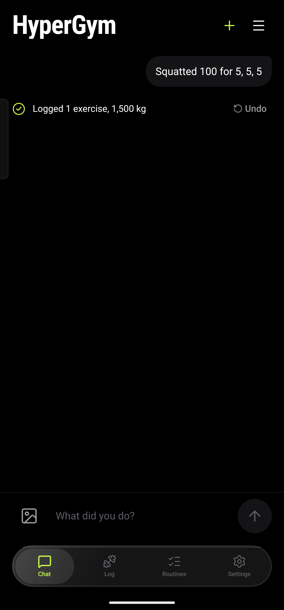
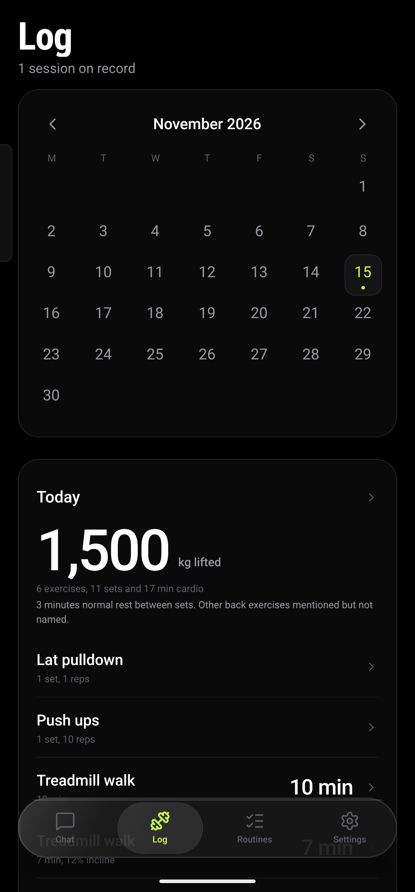
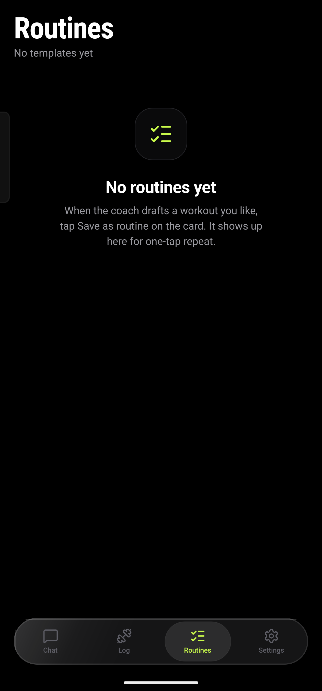
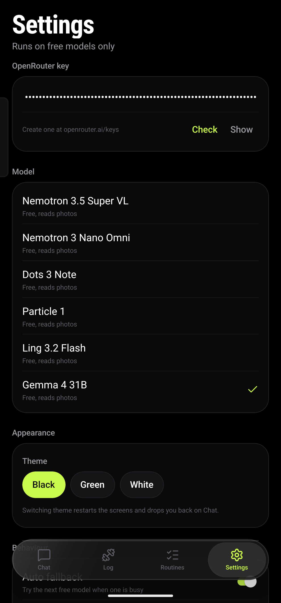

<div align="center">
  

  <h1>HyperGym</h1>

  <p><em>Say what you trained. The coach drafts it. Nothing is saved until you tap <b>Log it</b>.</em></p>

  <p>
    
    
    
    <a href="LICENSE"></a>
  </p>

  <p>
    <a href="../../releases/latest"><b>Download the APK</b></a>
  </p>
</div>

<br />

<p align="center">
  
  
  
  
</p>

Most gym apps want you to build a routine before you can record a set. HyperGym inverts that: you write *"4 sets bench at 80, 8 reps"* — or photograph the machine — and the draft comes back filled in. You correct what's wrong and confirm.

---

## Features

**Drafts, never guesses.** The coach returns an editable card. Every value it inferred is marked and counted, so you can see exactly what it assumed. Ambiguous input produces a question with tappable answers instead of a fabricated number.

**Separate conversations.** Each chat is saved and titled from your first message. Start a new one from the header, or delete any of them from the side panel.

**Progress that adds up.** A calendar of sessions, per-day volume, estimated 1RM, personal records and per-exercise trends.

**Routines.** Save any draft as a template and replay it in one tap.

**Yours alone.** No account, no server, no analytics. Everything lives in local storage, exportable as JSON.

## Design

Monochrome black with one lime accent, held under 10% of any screen so it only appears where it means something. Every colour, size and radius comes from `src/theme.ts` — there are no literal colours elsewhere.

The bottom navigation is a floating pane of liquid glass: translucent body, specular streak, lit rim, and a tinted lens that slides between tabs. It's pure vector, so there's no native dependency. Three themes — Black, Green, White — share one token contract.

All motion uses `transform` and `opacity`, and collapses to a fade under the system reduce-motion setting.

## Requirements

- Android 8.0+ (API 26), `arm64-v8a`
- Node.js 22.11+, JDK 17, Android SDK platform 35

## Setup

HyperGym talks to models through [OpenRouter](https://openrouter.ai). You supply your own free key.

1. Create one at [openrouter.ai/keys](https://openrouter.ai/keys).
2. Open **Settings → OpenRouter key** and paste it in.
3. Tap **Check** to verify.

The key stays in device storage and is only ever sent to `openrouter.ai`. Free tiers are rate limited; when a model returns `429`, the next one is tried automatically.

```sh
npm install
npm start          # Metro, in one terminal
npm run android    # in another, device attached

npm test           # 41 tests
npx tsc --noEmit   # typecheck
npm run lint
```

## Building

```sh
cd android
./gradlew assembleRelease
# → android/app/build/outputs/apk/release/app-release.apk
```

Signed with the standard debug keystore, which is fine for sideloading. For the Play Store, generate your own — see [React Native's signing guide](https://reactnative.dev/docs/signed-apk-android).

## How it works

```
src/
├── agent/        Draft parsing, tool-call rescue, delete resolution
├── ai/           OpenRouter client, SSE parser, prompt, tool schemas
├── components/   Glass tab bar, cards, composer, chat sidebar
├── lib/          Storage, dates, stats, motion, haptics
├── screens/      Chat, Log, Routines, Settings, detail views
├── store/        Zustand: chats, days, routines, settings
└── theme.ts      Palette, type scale, surfaces
```

`src/ai/prompt.ts` holds the logging rules — never invent a number, ask when ambiguous, report only what is visible. `src/ai/tools.ts` exposes `propose_workout` and `ask_clarification`; the model cannot write to the log directly.

Streaming runs over `XMLHttpRequest` because React Native's `fetch` cannot stream a response body. SSE parsing and tool-call accumulation live in `src/ai/sse.ts`.

`src/agent/parseDraft.ts` is the safety net: if a model ignores the tools and prints JSON in its reply, the draft is still recovered, and unknown numbers stay blank rather than defaulting to zero.

## Known limitations

- Photos are downscaled to 1024px to stay inside free-tier token limits.
- Free models occasionally misread a weight stack — which is why every draft is confirmed by a human.
- Only Android is configured; `ios/` is template scaffolding.
- The glass bar is layered translucency, not true backdrop blur — real blur needs a native dependency.

## License

[MIT](LICENSE)
